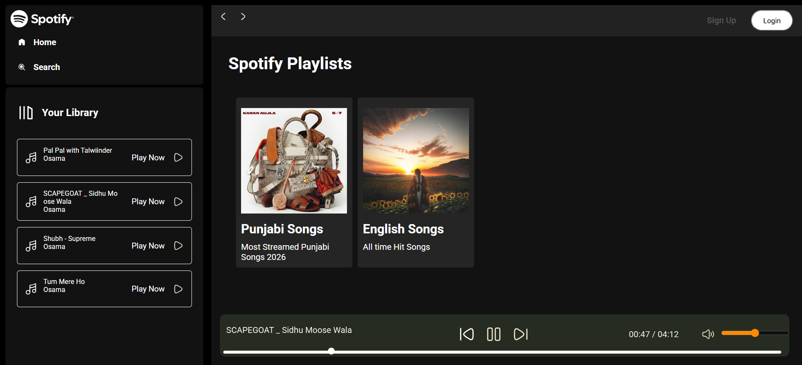

# Spotify Clone – Responsive Music Player 🎵

## About the Project

This project is a Spotify-inspired music player developed using **HTML, CSS, and JavaScript**. It recreates the core experience of a music streaming platform with a modern interface, dynamic playlists, and interactive audio controls. The application is designed to provide a smooth music-listening experience across desktop and mobile devices.

## Features

- **Dynamic Album Loading:** Loads music albums, titles, and descriptions from folders using `info.json` files.
- **Music Playback:** Play, pause, and switch between previous and next tracks.
- **Interactive Seek Bar:** Displays real-time playback progress and allows users to navigate to different parts of a song.
- **Volume Control:** Adjust audio volume using an interactive slider.
- **Responsive Design:** Adapts to different screen sizes, including desktops, tablets, and mobile devices.
- **Mobile Navigation:** Includes a hamburger menu for convenient navigation on smaller screens.
- **Modern Interface:** Features a Spotify-inspired layout with album cards, playlists, hover effects, and playback controls.

## Technologies Used

- **HTML5** – Structure and audio elements.
- **CSS3** – Styling, layouts, animations, and responsive design.
- **JavaScript** – Dynamic content loading, playlist management, and playback functionality.
- **HTML5 Audio API** – Audio playback and event handling.

## Project Structure

```text
spotify-clone/
├── index.html
├── style.css
├── script.js
├── songs/
│   ├── album-name/
│   │   ├── song.mp3
│   │   └── info.json
│   └── another-album/
└── assets/
```

*The structure above is illustrative; adjust it to match your actual project files.*

## Getting Started

1. Clone this repository:
   ```bash
   git clone https://github.com/osamamobeen1/Spotify-Clone
   ```
2. Open the project folder in Visual Studio Code.
3. Launch `index.html` using the Live Server extension.
4. Ensure your music files and `info.json` files are organized correctly.

## Learning Outcomes

This project strengthened my understanding of JavaScript DOM manipulation, asynchronous data loading, audio event handling, responsive web design, and interactive user interface development.

## Disclaimer

This project is created for educational purposes only and is not affiliated with or endorsed by Spotify.

